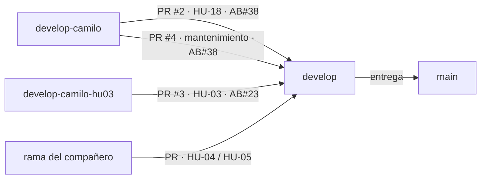

# Proceso de desarrollo: base del backend, HU-18 y HU-03

Registro del proceso seguido para construir la base del backend y las historias HU-18 (inicio de sesión, AB#38) y HU-03 (gestión de vehículos, AB#23) del Sistema de Gestión Logística (SGL). Sirve como guía para explicar el trabajo y como referencia del equipo.

- **Periodo:** 13 y 14 de octubre de 2026
- **Responsable:** Camilo (rama `develop-camilo`)
- **Trabajo en paralelo:** el compañero desarrolla HU-04 y HU-05 sobre esta base (ver `docs/CONTRATOS.md`)

---

## 1. Flujo de trabajo

### 1.1 Ramas

| Rama | Uso |
|---|---|
| `main` | Solo entregas. |
| `develop` | Integración. Todo llega por pull request (PR); no se trabaja directamente en ella. |
| `develop-camilo` | Trabajo de Camilo. |
| `develop-camilo-hu03` | Rama temporal para presentar HU-03 en un PR propio (sección 2, fase 7). Se conserva como evidencia. |
| Rama del compañero | Trabajo de HU-04 y HU-05. |



### 1.2 Reglas aplicadas

1. **Plan antes de código.** La estructura y el plan de cada historia se aprobaron antes de programar.
2. **Commits pequeños**, cada uno con un propósito, enlazados a Azure DevOps con `AB#<número>`.
3. **Una historia por PR**, con su tabla de criterios de aceptación y la evidencia de pruebas.
4. **Verificación antes de subir:** compilación, pruebas automáticas y prueba manual en navegador.
5. **Módulos independientes:** cada integrante trabaja en su carpeta y registra sus rutas en un único punto, sin modificar los módulos del otro.

### 1.3 Trazabilidad con Azure DevOps

Cada commit incluye `AB#38` o `AB#23` en el mensaje. Azure DevOps los muestra en la sección *Development* del ítem correspondiente, de modo que desde la historia se llega al código y desde el código a la historia.

---

## 2. Línea de tiempo

### Fase 0 · Análisis y plan

- Lectura de `HU-18-inicio-sesion.md`, `HU-03-gestion-vehiculos.md`, `HU-04`, `HU-05` y `diagrama-clases-sgl.mmd`.
- Revisión del frontend existente: no usaba el Router de Angular (cambiaba de pantalla con una señal), por lo que HU-18 exigía introducirlo para poder proteger rutas.
- Propuesta de estructura en capas y plan de HU-18 con cada criterio de aceptación asignado a backend o frontend.
- Decisiones aprobadas: ver sección 3.

### Fase 1 · Base del backend (AB#38)

| Commit | Contenido |
|---|---|
| `7dd1009` | Proyecto Node.js + Express 5 + TypeScript, validación de variables de entorno, `.env.example` |
| `84a85fe` | Conexión a PostgreSQL, transacciones y migraciones SQL versionadas |
| `1496d69` | Formato de error común `{ codigo, mensaje }`, CORS restringido y encabezados de seguridad |

### Fase 2 · HU-18 en el backend (AB#38)

| Commit | Contenido |
|---|---|
| `1358221` | Tablas `usuarios`, perfiles por rol y `bitacora_intentos_fallidos` |
| `52da695` | Hash de contraseñas con bcrypt y usuarios de prueba |
| `6ebe1db` | `POST /api/auth/login` con JWT y registro de intentos fallidos |
| `6f7348c` | Middlewares `autenticar` y `autorizar` (control de acceso por rol en cada endpoint) |
| `d995c78` | Pruebas automáticas de login y control de acceso |

### Fase 3 · HU-18 en el frontend (AB#38)

| Commit | Contenido |
|---|---|
| `bc9f6be` | Sincronización del `package-lock.json` (`npm ci` fallaba) |
| `6201086` | Router de Angular y layout común, sin cambios visuales |
| `aa365d1` | `AuthService`, interceptor HTTP y mensajes de error de red |
| `f3c2998` | Pantalla de inicio de sesión con validación de campos |
| `3be0f22` | Guards por rol, menú por rol y cierre de sesión |

### Fase 4 · Acuerdos para trabajar en paralelo (AB#38)

| Commit | Contenido |
|---|---|
| `feeada9` | `docs/CONTRATOS.md`: cómo agregar módulos, proteger endpoints, tablas que se pueden referenciar y archivos compartidos |

### Fase 5 · HU-03 en el backend (AB#23)

| Commit | Contenido |
|---|---|
| `dbf0480` | Tabla `vehiculos` (primero, porque HU-04 la necesita) |
| `18a819b` | Registro y consulta con normalización y validación de placa por tipo |
| `98d0c78` | Edición y desactivación lógica |
| `d39c828` | Solicitudes idempotentes: reintentos sin duplicar |
| `6ef4a50` | Pruebas de vehículos e idempotencia |

### Fase 6 · HU-03 en el frontend (AB#23)

| Commit | Contenido |
|---|---|
| `d2f0ece` | Modelo, servicio y validador de placa |
| `a2dbebe` | Página de flota conectada a la API, con registro y edición |
| `581dc6e` | Desactivación con confirmación |
| `dfaebcf` | Pruebas de la página de flota y actualización de contratos |

### Fase 7 · Integración

1. Se abrió el **PR #2** de `develop-camilo` hacia `develop` con HU-18.
2. Los commits de HU-03 quedaron en el mismo PR. Para revisar cada historia por separado:
   - se creó `develop-camilo-hu03` con HU-03;
   - `develop-camilo` volvió al último commit de HU-18;
   - se abrió el **PR #3** contra `develop-camilo`, para que mostrara solo los cambios de HU-03 (PR dependiente).
3. Se fusionó el PR #2 en `develop`, se cambió la base del PR #3 a `develop` y se fusionó.
4. `develop-camilo` se actualizó hasta `develop` para continuar desde la versión integrada.

### Fase 8 · Base de datos en la nube

- Se compararon servicios gratuitos de PostgreSQL. Se eligió **Neon**: su plan gratuito no expira, a diferencia de Render, que borra la base a los 30 días, y no pausa el proyecto por inactividad, como Supabase.
- Se creó el proyecto con solo *Postgres database* activado: sin Neon Auth, porque la autenticación ya está en el backend.
- Las tablas se crearon con `npm run migrate:up` y los usuarios con `npm run seed` desde el computador del responsable. La cadena de conexión vive solo en el `.env`, que git excluye.

### Fase 9 · Mantenimiento (PR #4, AB#38)

| Commit | Contenido |
|---|---|
| `0ca535d` | Angular 21.2.23 → 21.2.25: corrige las 7 vulnerabilidades de `npm audit` (de 7 a 0) |
| `0a98823` | Documentación de la base compartida en Neon |

### Pull requests

| PR | Contenido | Estado |
|---|---|---|
| [#2](https://github.com/Camlopez98/sgl-gestion-logistica/pull/2) | HU-18 y base del backend | Fusionado |
| [#3](https://github.com/Camlopez98/sgl-gestion-logistica/pull/3) | HU-03 | Fusionado |
| [#4](https://github.com/Camlopez98/sgl-gestion-logistica/pull/4) | Vulnerabilidades y Neon | Fusionado |

---

## 3. Decisiones de arquitectura

| Decisión | Alternativas | Justificación |
|---|---|---|
| Arquitectura en capas: rutas → controlador → servicio → repositorio (RD-02) | Controladores con SQL directo | Separa responsabilidades: HTTP, reglas de negocio y acceso a datos se prueban y cambian por separado [1], [2]. |
| Un módulo por carpeta y registro de rutas en un solo archivo | Rutas repartidas | El compañero agrega módulos sin tocar los existentes (principio abierto/cerrado) [3]. |
| Herencia de roles: tabla `usuarios` + una tabla de perfil por rol | Una sola tabla con columnas nulas | Refleja el diagrama de clases (`Rol` y sus subclases). Una clave foránea compuesta `(usuario_id, rol)` impide asignar un perfil a un usuario de otro rol [2]. |
| Contraseñas con bcrypt | Cifrado reversible | Hash con salt y costo configurable; nunca se guarda la contraseña [4]. |
| JWT con renovación por actividad | Sesiones en servidor | Token firmado con expiración [5]. Si al token le queda menos de la mitad de su vida, el servidor entrega uno nuevo; sin actividad durante 30 min, la sesión expira (CA 11). |
| Mismo mensaje para correo inexistente y contraseña errónea | Mensajes distintos | No revela qué correos están registrados (CA 5) [6]. |
| Verificar en cada petición que el usuario siga activo | Confiar solo en el token | Un usuario desactivado pierde el acceso de inmediato. |
| Formato de error común `{ codigo, mensaje }` | Errores por endpoint | El frontend maneja todos los errores igual; los códigos HTTP siguen su semántica estándar [7]. |
| Migraciones SQL versionadas (node-pg-migrate) | Crear tablas a mano | El esquema queda en el repositorio y se reproduce en cualquier base [8]. |
| Placa validada en cliente, servidor y base de datos | Validar solo en el cliente | Defensa en profundidad: la restricción `CHECK` y `UNIQUE` de la base son la última barrera. |
| `Idempotency-Key` para registrar vehículos | Solo la restricción `UNIQUE` | Un reintento tras una falla devuelve el vehículo ya creado en lugar de un error confuso (CA 9 y 10). Es reutilizable en HU-04 (CA 17). |
| Consulta de "viaje activo" desacoplada | Consultar la tabla de viajes directamente | La tabla de viajes aún no existe; el módulo de viajes registrará su consulta sin modificar vehículos. |
| Sesión en `sessionStorage` | `localStorage` o cookie | Se borra al cerrar el navegador; útil en dispositivos compartidos (relacionado con HU-05). |
| Neon como base compartida | Render, Supabase | Plan gratuito sin expiración ni pausa por inactividad; PostgreSQL estándar. |

---

## 4. Trazabilidad de criterios de aceptación

### HU-18 · Inicio de sesión (AB#38)

| CA | Implementación | Prueba automática |
|---|---|---|
| 1-3 Redirección por rol | `auth.service.ts` (backend) devuelve el rol; `RUTA_INICIO_POR_ROL` y `login-page.ts` redirigen | `auth.login.test.ts`, `login-page.spec.ts`, `auth.guards.spec.ts` |
| 4 Contraseña equivocada | 401 `CREDENCIALES_INVALIDAS`; mensaje en rojo | `auth.login.test.ts`, `login-page.spec.ts` |
| 5 Correo no registrado | Mismo 401 y comparación con hash ficticio | `auth.login.test.ts` |
| 6 Campos inválidos | Formulario reactivo no envía; servidor responde 422 | `login-page.spec.ts`, `auth.login.test.ts` |
| 7 Cuenta inactiva | 403 `CUENTA_INACTIVA` | `auth.login.test.ts`, `login-page.spec.ts` |
| 8 Conductor abre URL del administrador | `rolGuard` lo devuelve a su módulo | `auth.guards.spec.ts` |
| 9 Contador escribe directo al servidor | `autorizar` responde 403 | `auth.acceso.test.ts`, `vehiculos.test.ts` |
| 10 Sin sesión | `authGuard` y `autenticar` (401) | `auth.guards.spec.ts`, `auth.acceso.test.ts` |
| 11 Sesión expirada | Expiración del JWT, renovación por actividad, aviso en el login | `auth.acceso.test.ts`, `auth.service.spec.ts`, `auth.interceptor.spec.ts` |
| 12 Botón "atrás" tras cerrar sesión | Sesión borrada, `replaceUrl`, guards, `Cache-Control: no-store` | `auth.guards.spec.ts`, `auth.service.spec.ts` |
| 13 Bitácora de intentos fallidos | Tabla `bitacora_intentos_fallidos` | `auth.login.test.ts` |
| 14 Sin conexión | `mensajeDeError` detecta la falta de internet | `mensaje-error.spec.ts`, `login-page.spec.ts` |
| 15 Servidor sin respuesta o con error | Mensaje claro y botón "Reintentar" | `mensaje-error.spec.ts`, `login-page.spec.ts` |

### HU-03 · Gestión de vehículos (AB#23)

| CA | Implementación | Prueba automática |
|---|---|---|
| 1 Registro con estado activo | `POST /api/vehiculos` | `vehiculos.test.ts`, `fleet-page.spec.ts` |
| 2 Placa duplicada | 409 `PLACA_DUPLICADA` + `UNIQUE` | `vehiculos.test.ts`, `fleet-page.spec.ts` |
| 3 Formato según tipo | Validación en cliente y servidor (422) + `CHECK` en la base | `vehiculos.test.ts`, `placa.spec.ts`, `fleet-page.spec.ts` |
| 4 Normalización (`tkm-482` → `TKM482`) | `normalizarPlaca` en cliente y servidor | `vehiculos.test.ts`, `placa.spec.ts` |
| 5 Edición con placa de otro vehículo | 409 al editar | `vehiculos.test.ts`, `fleet-page.spec.ts` |
| 6 Inactivo sigue en el histórico | Desactivación lógica; listado con inactivos | `vehiculos.test.ts`, `fleet-page.spec.ts` |
| 7 Vehículo en viaje activo | 409 `VEHICULO_EN_VIAJE_ACTIVO` (**pendiente** de conectar con la tabla de viajes) | `vehiculos.test.ts` (con viaje simulado), `fleet-page.spec.ts` |
| 8 Sin conexión | El servicio no envía y el formulario conserva los datos | `vehiculo.service.spec.ts` |
| 9 Servidor caído al reintentar | `Idempotency-Key` | `idempotencia.test.ts`, `fleet-page.spec.ts` |
| 10 Reenvío automático | Reenvío con la misma clave + `UNIQUE`; registro simultáneo crea uno solo | `vehiculos.test.ts`, `vehiculo.service.spec.ts` |

---

## 5. Calidad y verificación

| Verificación | Resultado |
|---|---|
| Pruebas del backend (Vitest + supertest, base de pruebas aparte) | 71 pruebas pasando |
| Pruebas del frontend (Vitest) | 82 pruebas pasando |
| Compilación de producción del frontend | Sin advertencias |
| `npm audit` (backend y frontend) | 0 vulnerabilidades |
| Prueba manual en navegador | Login de los tres roles, menú por rol, rechazo del conductor en el dashboard, registro, edición, filtros y desactivación de vehículos, aviso sin conexión |
| Prueba contra Neon | Login de conductor y administrador; vehículo registrado y leído desde la base en la nube |

Comandos para repetir la verificación:

```bash
cd backend && npm test
cd frontend && npx ng test --watch=false && npx ng build
```

---

## 6. Pendientes y limitaciones conocidas

- **HU-03, CA 7:** la regla "no desactivar un vehículo en viaje activo" está implementada y probada con datos simulados. Funcionará con datos reales cuando el módulo de viajes llame a `registrarConsultaViajeActivo()`.
- **Cierre de sesión:** el token JWT no se invalida en el servidor (es sin estado). El frontend lo elimina, y la verificación del estado activo en cada petición corta el acceso de usuarios desactivados.
- **Renovación de sesión:** ocurre cuando una pantalla llama a la API. Las pantallas que aún usan datos de ejemplo no la provocan.
- **Pantallas provisionales:** "Mis viajes en curso" (Conductor) y "Visor de reportes" (Contador) existen como destino de la redirección; su contenido pertenece a otras historias.
- **Capacidad de carga:** la HU-03 no fija un máximo; se acepta cualquier valor mayor que cero.

---

## 7. Guion sugerido para la presentación

1. **Contexto:** tres roles, dos historias asignadas y el trabajo en paralelo con el compañero.
2. **Plan antes de código:** estructura en capas y decisiones de la sección 3.
3. **Flujo de trabajo:** ramas, commits con `AB#`, un PR por historia y el caso del PR dependiente (fase 7).
4. **Demostración:**
   - login de cada rol y su menú;
   - un conductor intentando abrir `/admin/dashboard`;
   - registro de un vehículo con placa `tkm-482`, que se guarda como `TKM482`;
   - placa duplicada y placa con formato incorrecto;
   - desactivación sin borrado.
5. **Evidencia:** tablas de trazabilidad (sección 4) y ejecución de las pruebas.
6. **Base en la nube:** Neon, migraciones versionadas y manejo seguro de la cadena de conexión.
7. **Pendientes:** sección 6.

---

## Referencias

1. F. Buschmann, R. Meunier, H. Rohnert, P. Sommerlad y M. Stal, *Pattern-Oriented Software Architecture, Vol. 1: A System of Patterns*. Wiley, 1996 (patrón *Layers*).
2. M. Fowler, *Patterns of Enterprise Application Architecture*. Addison-Wesley, 2002 (*Service Layer*, *Table Data Gateway*, *Class Table Inheritance*).
3. B. Meyer, *Object-Oriented Software Construction*. Prentice Hall, 1988 (principio abierto/cerrado).
4. N. Provos y D. Mazières, "A Future-Adaptable Password Scheme", en *Proc. USENIX Annual Technical Conference*, 1999 (bcrypt).
5. M. Jones, J. Bradley y N. Sakimura, "JSON Web Token (JWT)", RFC 7519, IETF, 2015.
6. OWASP Foundation, "Authentication Cheat Sheet", OWASP Cheat Sheet Series.
7. R. Fielding, M. Nottingham y J. Reschke, "HTTP Semantics", RFC 9110, IETF, 2022.
8. S. Ambler y P. Sadalage, *Refactoring Databases: Evolutionary Database Design*. Addison-Wesley, 2006.
